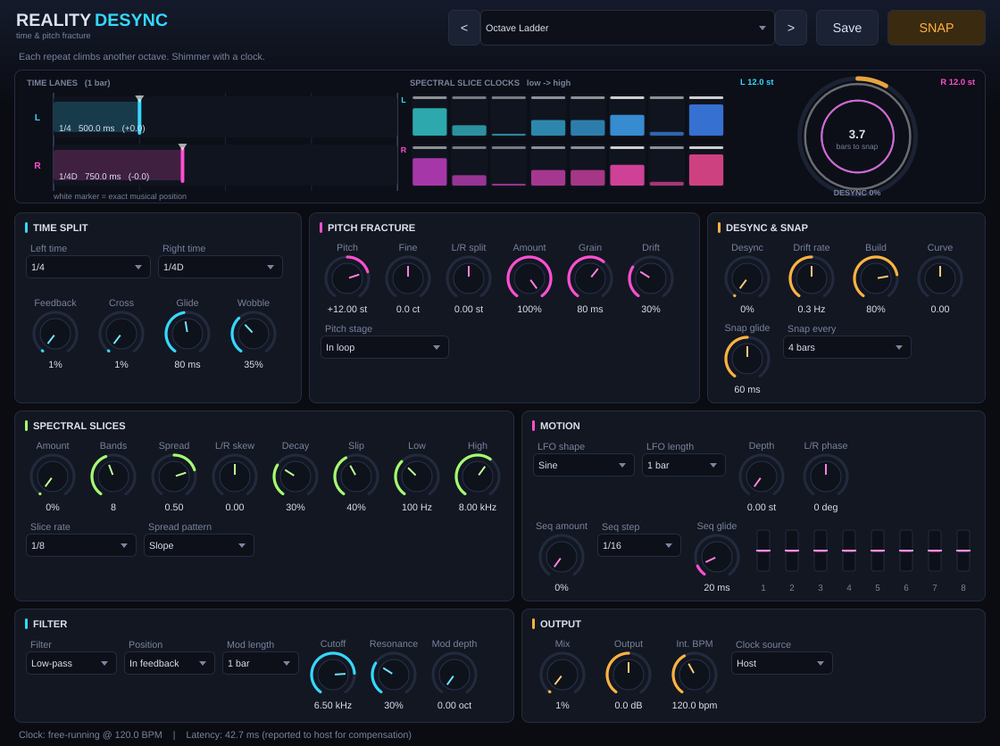

# Reality Desync

A time and pitch fracture effect (VST3). Different parts of the sound seem to run at different speeds, then everything snaps back into alignment on a bar line.

* **Left and right delayed by different musical fractions** (22 note lengths, triplets and dotted values included, locked to host tempo).
* **Pitch modulated independently of playback speed.** A granular shifter sits in, before or after the delay, with fine tune, L/R split, LFO (7 shapes), an 8-step pitch sequencer and random drift.
* **Spectral slices retriggered at different rates.** Up to 16 frequency bands each freeze and re-fire on their own tempo-locked clock. Fan the rates out as a slope, alternating or scattered, and skew the right channel against the left.
* **Rhythm locked, texture drifting.** Every delay time, retrigger clock and pitch step is derived from the transport. Only the *texture* wanders (time wobble, pitch drift, slice slip), and only by the amount of Desync you dial in.
* **Snap on the bar line.** Every 1 to 32 bars (or on demand with SNAP) the drift glides to zero and every band restarts together.
* 32 factory presets, a resonant filter (LP/BP/HP/notch) in the feedback loop or on the wet output, 55 automatable parameters.

Latency is 2048 samples (about 43 ms at 48 kHz). It is reported to the host, so hosts with plugin delay compensation line it up automatically.

## Download

Get the latest build for your system from the **[Releases page](https://github.com/atruenut/RealityDesync/releases/latest)**:

| Platform | File | Install to |
|---|---|---|
| Windows 10/11, 64-bit | `RealityDesync-<version>-Windows-x64.zip` | `C:\Program Files\Common Files\VST3\` |
| macOS 10.13+, Apple silicon and Intel | `RealityDesync-<version>-macOS-universal.zip` | `/Library/Audio/Plug-Ins/VST3/` or `~/Library/Audio/Plug-Ins/VST3/` |
| Linux, x86-64 | `RealityDesync-<version>-Linux-x64.zip` | `~/.vst3/` |

Unzip, copy the **`Reality Desync.vst3`** folder (Windows, Linux) or bundle (macOS) to the location above, and rescan plugins in your DAW. It appears as **Reality Desync** (Fx > Delay). Every zip also has an `INSTALL.txt`, and `SHA256SUMS.txt` is on the release page.

All three builds are the full edition with the **custom interface**. A full explanation of every control, with a worked example, is in **[GUIDE.md](GUIDE.md)**.



**macOS:** the plugin is ad-hoc signed but not notarised. If macOS refuses to load it, run
`xattr -dr com.apple.quarantine "/Library/Audio/Plug-Ins/VST3/Reality Desync.vst3"`.

Presets: pick one in the plugin's own browser (top bar, with Save for your own), or in your host's preset menu. They are published as 32 named programs.

## Two editions, one engine

| | **Full edition** (Releases page) | **Lite edition** (`prebuilt/`) |
|---|---|---|
| Interface | custom GUI: live "fracture scope", preset browser, Save/Load user presets | none: the host's generic parameter screen |
| Built with | JUCE 8 on GitHub Actions: MSVC (Windows), Xcode clang (macOS), gcc (Linux) | VST3 SDK only, MinGW-w64 gcc (`vst3-plain/`) |
| Verified | Steinberg `validator` 47 passed, 0 failed; loads and creates its editor through a VST3 host path (Linux) | Steinberg `validator` 537 passed, 0 failed (Linux build) |

Both use the same DSP core (`src/core`), the same 55 parameters and the same 32 presets (`src/core/ParamTable.cpp`). The Lite edition exists so the plugin can also be built with plain MinGW, which JUCE does not support. **Install only one of them**, because both show up as "Reality Desync".

## Rebuild it yourself

**Windows with MinGW-w64 (what you already use):** double-click `build_windows.bat` in the repo root. It fetches the VST3 SDK the first time (needs git) and writes `dist\Reality Desync.vst3\...`.

**From Linux/macOS to Windows:** `./build_cross_to_windows.sh` (needs `x86_64-w64-mingw32-g++`).

**CMake, any platform:**
```
git clone --recurse-submodules https://github.com/steinbergmedia/vst3sdk
cmake -S vst3-plain -B build -DVST3_SDK_DIR=vst3sdk
cmake --build build
```
**Full edition (custom GUI):** `cmake -S . -B build` then `cmake --build build --config Release --target RealityDesync_VST3`. JUCE 8 is fetched automatically (or pass `-DJUCE_DIR=/path/to/JUCE`). Add `-DRD_BUILD_STANDALONE=ON` for a standalone app. Releases are built by `.github/workflows/release.yml` when a `v*` tag is pushed.

**Tests:** `rd_dsp_tests` (built by the root CMake) checks delay accuracy, tempo tracking, pitch accuracy, spectral reconstruction, the bar-line snap and stability.

## Honest notes

* The Linux build of the full edition was validated here (Steinberg validator, host-path load, rendered GUI). The Windows and macOS builds are compiled on GitHub's Windows and macOS machines from the same source and I have not been able to run them in a DAW, so please report any host that misbehaves.
* macOS builds are not notarised (see the note above).
* Only 32-bit float audio is processed (every DAW supports this). Stereo in, stereo out.
* Latency is 2048 samples (about 43 ms at 48 kHz), reported to the host for delay compensation.

Third-party: JUCE 8 (AGPL/commercial licence) for the full edition; Steinberg VST3 SDK (MIT) for the Lite edition. VST is a trademark of Steinberg Media Technologies GmbH.

## Repository layout

| Path | Contents |
|---|---|
| `src/core/` | Portable DSP engine, parameter table and the 32 presets (no dependencies) |
| `src/vst3/` | Plain VST3 SDK front-end (the Lite edition) |
| `src/plugin/` | JUCE front-end with the custom GUI (the Releases builds) |
| `vst3-plain/` | CMake file for the Lite VST3 build |
| `.github/workflows/` | Builds and publishes releases |
| `tests/` | DSP tests and headless plugin check |
| `prebuilt/` | Lite-edition builds (no GUI) |
| `GUIDE.md` | In-depth user guide and preset list |

Licence: the Reality Desync source is MIT (see [LICENSE](LICENSE)). The full-edition binaries link JUCE, which is AGPLv3 unless you hold a JUCE commercial licence, so distributing those binaries means complying with the AGPL (source available, which this repository provides).
