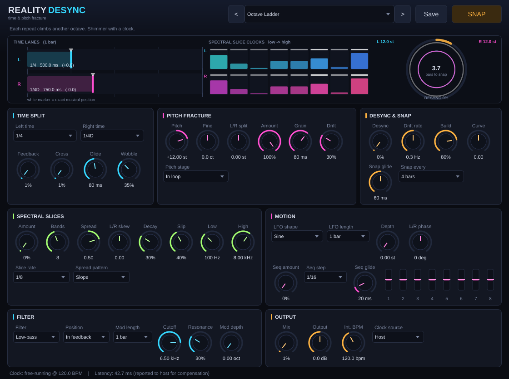

# Reality Desync

A time and pitch fracture effect (VST3). Different parts of the sound seem to run at different speeds, then everything snaps back into alignment on a bar line.

* **Left and right delayed by different musical fractions** (22 note lengths, triplets and dotted values included, locked to host tempo).
* **Pitch modulated independently of playback speed.** A granular shifter sits in, before or after the delay, with fine tune, L/R split, LFO (7 shapes), an 8-step pitch sequencer and random drift.
* **Spectral slices retriggered at different rates.** Up to 16 frequency bands each freeze and re-fire on their own tempo-locked clock. Fan the rates out as a slope, alternating or scattered, and skew the right channel against the left.
* **Rhythm locked, texture drifting.** Every delay time, retrigger clock and pitch step is derived from the transport. Only the *texture* wanders (time wobble, pitch drift, slice slip), and only by the amount of Desync you dial in.
* **Snap on the bar line.** Every 1 to 32 bars (or on demand with SNAP) the drift glides to zero and every band restarts together.
* 32 factory presets, a resonant filter (LP/BP/HP/notch) in the feedback loop or on the wet output, 55 automatable parameters.

Latency is 2048 samples (about 43 ms at 48 kHz). It is reported to the host, so hosts with plugin delay compensation line it up automatically.

## Download

**[Download the Windows VST3 (64-bit)](https://github.com/atruenut/RealityDesync/raw/main/prebuilt/RealityDesync-1.0-Windows-x64.zip)**, or grab it from the [`prebuilt/`](prebuilt) folder. A Linux build is there too. Checksums are in [`prebuilt/SHA256SUMS.txt`](prebuilt/SHA256SUMS.txt).

## Install (Windows)

1. Unzip and copy the folder **`Reality Desync.vst3`** into `C:\Program Files\Common Files\VST3\`.
2. Rescan plugins in your DAW. It appears as **Reality Desync** (Fx > Delay).

The file inside that folder is a normal 64-bit Windows DLL (a VST3 plugin is a DLL with the extension `.vst3`). A copy named `RealityDesync.dll` is in `prebuilt/Windows/` for reference only. Hosts scan for `.vst3`, so use the folder. The DLL is statically linked and needs no extra runtime files.

Choose a preset from your host's preset menu (published as the plugin's program list). The host's generic parameter screen shows all controls. A full explanation of every control, with a worked example, is in **[GUIDE.md](GUIDE.md)**.


*The JUCE edition's custom interface: live delay lanes, per-band slice clocks and the alignment ring. The prebuilt Windows DLL uses the host's generic UI instead (see below).*

## Two editions, one engine

| | `vst3-plain/` (the prebuilt Windows DLL) | JUCE edition (root `CMakeLists.txt`) |
|---|---|---|
| Builds with | MinGW-w64 gcc, MSVC, clang, gcc | MSVC, clang, gcc on Linux/macOS (JUCE 8 does not support MinGW) |
| Interface | the host's generic parameter UI + native preset list | custom GUI: live "fracture scope", preset browser, Save/Load user presets |
| Verified | Steinberg `validator`: 537 passed, 0 failed (Linux build) | all presets rendered and GUI inspected on Linux |

Both use the same DSP core (`src/core`), the same 55 parameters and the same 32 presets (`src/core/ParamTable.cpp`).

## Rebuild it yourself

**Windows with MinGW-w64 (what you already use):** double-click `build_windows.bat` in the repo root. It fetches the VST3 SDK the first time (needs git) and writes `dist\Reality Desync.vst3\...`.

**From Linux/macOS to Windows:** `./build_cross_to_windows.sh` (needs `x86_64-w64-mingw32-g++`).

**CMake, any platform:**
```
git clone --recurse-submodules https://github.com/steinbergmedia/vst3sdk
cmake -S vst3-plain -B build -DVST3_SDK_DIR=vst3sdk
cmake --build build
```
**JUCE edition (custom GUI):** `cmake -S . -B build-juce -DJUCE_DIR=/path/to/JUCE` then build. JUCE is fetched automatically if `JUCE_DIR` is not given. Add `-DRD_BUILD_STANDALONE=ON` for a standalone app.

**Tests:** `rd_dsp_tests` (built by the root CMake) checks delay accuracy, tempo tracking, pitch accuracy, spectral reconstruction, the bar-line snap and stability.

## Honest notes

* The Windows DLL was cross-compiled and the same source was validated on Linux. I could not run it inside a Windows DAW here, so please tell me if any host misbehaves.
* The `.bat` is the same build recipe as the tested shell script, but I could not run it on Windows.
* Only 32-bit float audio is processed (every DAW supports this). Stereo in, stereo out.
* The Windows plugin uses your host's generic UI. The custom GUI exists only in the JUCE edition.

Third-party: Steinberg VST3 SDK (MIT licence); JUCE 8 for the JUCE edition (AGPL/commercial). VST is a trademark of Steinberg Media Technologies GmbH.

## Repository layout

| Path | Contents |
|---|---|
| `src/core/` | Portable DSP engine, parameter table and the 32 presets (no dependencies) |
| `src/vst3/` | Plain VST3 SDK front-end (the Windows DLL) |
| `src/plugin/` | JUCE front-end with the custom GUI |
| `vst3-plain/` | CMake file for the plain VST3 build |
| `tests/` | DSP tests and headless plugin check |
| `prebuilt/` | Ready-to-use Windows and Linux builds |
| `GUIDE.md` | In-depth user guide and preset list |

No licence file has been added yet. Until one is, all rights are reserved by the author.
